<p align="center">
  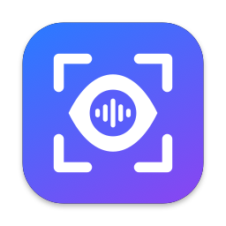
</p>

<h1 align="center">Glimpse</h1>

<p align="center">
  A fast, native macOS screenshot tool that lives in your menu bar.<br>
  Capture an area, a window, a whole page. Annotate it, redact it, pin it, drag it anywhere.<br>
  Record your screen with your camera and voice. Record your meetings and get a transcript.
</p>

<p align="center">
  <a href="https://milad.cloud/glimpse/"><strong>milad.cloud/glimpse</strong></a>
</p>

<p align="center">
  
  
  
  <a href="LICENSE"></a>
</p>

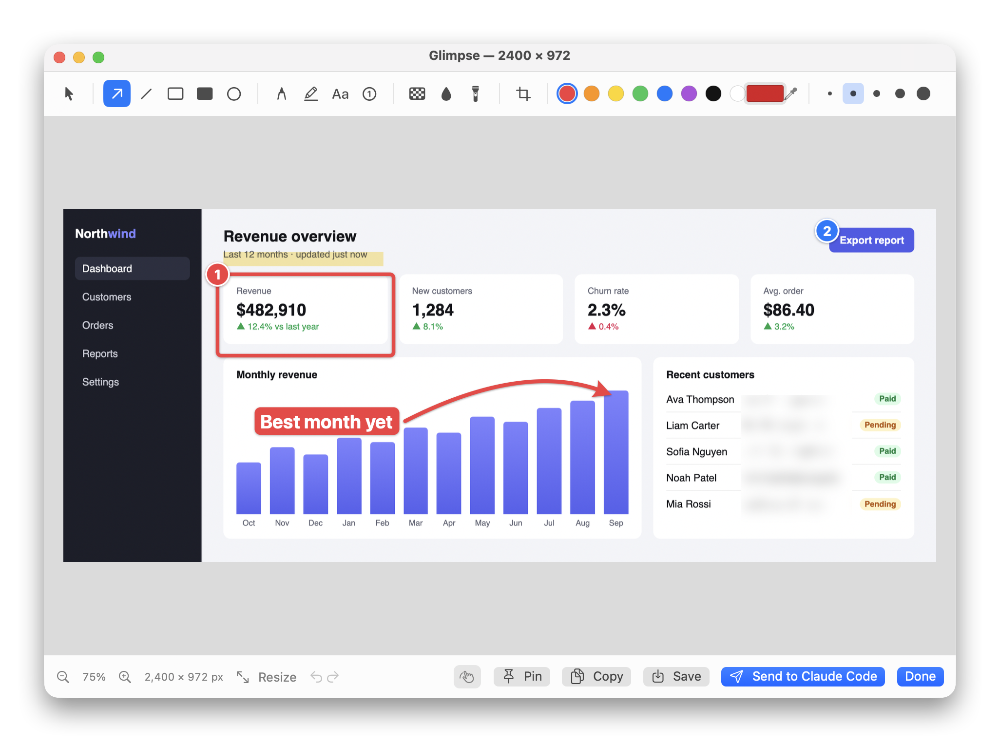

## Features

### Capture

- **Area** on a frozen screen, with crosshair, pixel magnifier and live size. `Space` switches to window mode.
- **Window** as a clean cut-out with transparent corners and an optional soft shadow.
- **Fullscreen**, **previous area**, and a **self-timer** (3, 5 or 10 seconds).
- **Scrolling capture** of long pages, chats and documents. Scroll yourself or let auto-scroll do it;
  sticky headers and footers appear once.
- **Capture text (OCR)** copies the text in any area, and reads QR codes. Runs on-device.

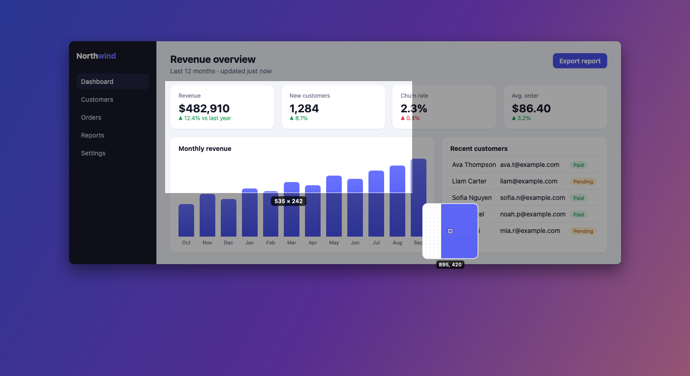

### Record

- **Screen recording** of an area or a whole display to MP4 (H.264, 30 or 60 fps, Retina or 1×). Drag to
  select, click for the full screen, or press `Space` to snap to a window. Also **Record Full Screen** from
  the menu.
- **Camera bubble**: your webcam in a round (or rounded-square) window that's part of the recording. Drag it
  anywhere, scroll or pinch to resize, double-click to cycle small / medium / large; right-click to mirror
  or hide it.
- **Audio** from the microphone and from the system (Glimpse's own sounds left out), mixed into one track so
  every player plays both.
- A compact control bar with a timer, mic level, **pause/resume**, restart, camera toggle, discard and **Stop**.
  It sits below the recorded area and stays out of the video; drag it by its grip (or anywhere that isn't a
  button) to move it. A countdown (off, 3, 5 or 10 seconds) before it starts; the cursor and, on macOS 15+,
  clicks can be shown.
- While recording, the menu bar icon turns into a red dot with the elapsed time.
- The finished video slides into the corner like a screenshot: play it, copy it, show it in Finder, trash it
  or drag the file into any app. Files are saved to the screenshots folder as
  `Glimpse Recording 2026-09-29 at 14.03.22.mp4`.

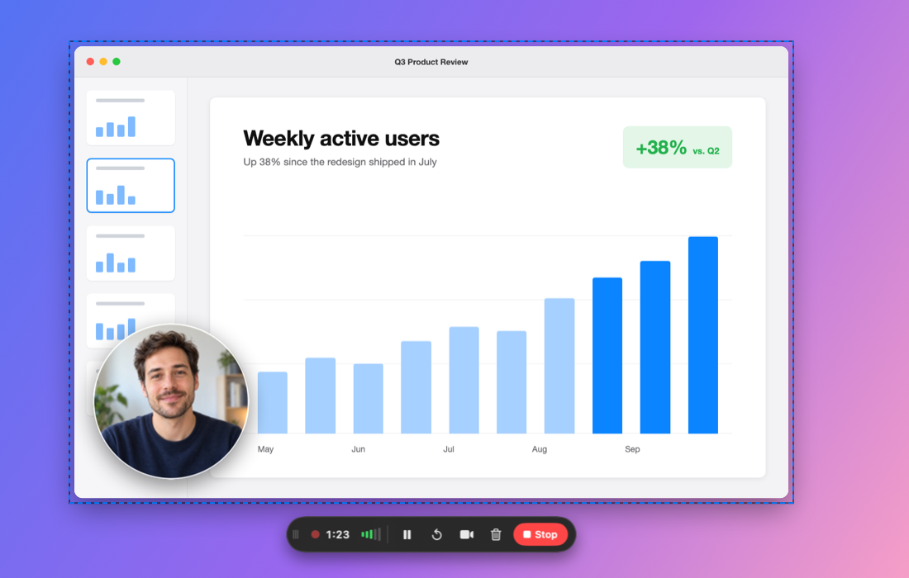

### Meetings

Glimpse can record your video calls and turn them into a transcript, all on this Mac. Turn it on with
**Settings › Meetings › Record meetings**.

- **Notices calls** in Google Meet, Zoom, Microsoft Teams, Slack huddles, Discord, FaceTime, Webex and Tuple by
  combining signals: a meeting window, the camera in use, call traffic on the network, your voice, and a calendar
  event happening now. Nothing is recorded until you say so, unless you turn on **Start recording automatically**.
- **Start Recording** from the Meetings submenu at any time, or **Join & Record** an upcoming calendar meeting.
  When a call is detected during a calendar meeting, a card offers to record it (once per meeting).
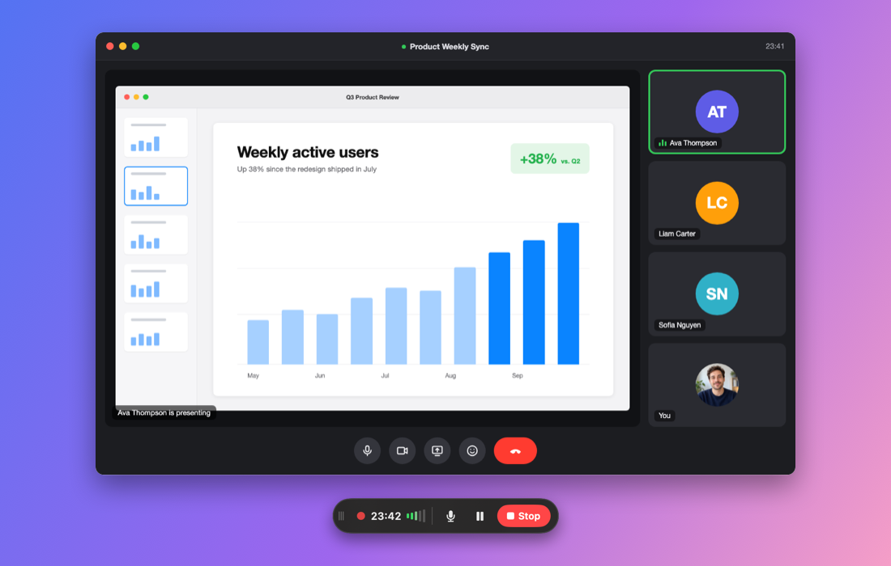

- **Records both sides**: your microphone on one channel and the call's system audio on the other, as a WAV file.
  A floating pill, built like the screen recording bar, shows the level and elapsed time with mute, pause and stop;
  drag it wherever it's out of the way. `⌃⌥M` mutes your microphone system-wide (the call app still shows you
  unmuted, but hears silence); when no recording pill is on screen, a small draggable **Microphone muted** badge
  with an **Unmute** button keeps the mute from going unnoticed.
- **Knows when it's over**: after a quiet stretch it asks whether the meeting ended and stops by itself if you don't
  answer. A recording interrupted by a crash or quit is finished the next time Glimpse opens.
- **Transcribes on-device** with Parakeet (speech to text) and a diarization model that separates speakers, both
  from [FluidAudio](https://github.com/FluidInference/FluidAudio) and downloaded on first use. Add your name so
  your side is labelled with it; a 15-second voice sample lets Glimpse recognise your voice when the channels
  aren't separated, and in a one-on-one the other person's voice can be learned from the transcript so later
  meetings name them too.
- **Transcripts** are markdown with the title, date, duration, attendees and meeting link, then one paragraph per
  speaker turn. They're written to `~/Glimpse/Meetings/<yyyy-MM-dd>/<yyyyMMddHHmm>-<Title>.md` (the folder is yours
  to change in **Settings › General**) so notes apps, scripts and AI agents can read them.
- **Transcription History** lists every recording with its transcript, attendees, timings and files; reassign a
  recording to a different calendar event, or delete it (recording and transcript go to the Trash).
- **Google Calendar** is optional. Sign in once (read-only access, through your own OAuth client file) and Glimpse
  titles recordings after the event, lists attendees, and shows the next 24 hours of meetings in the menu.

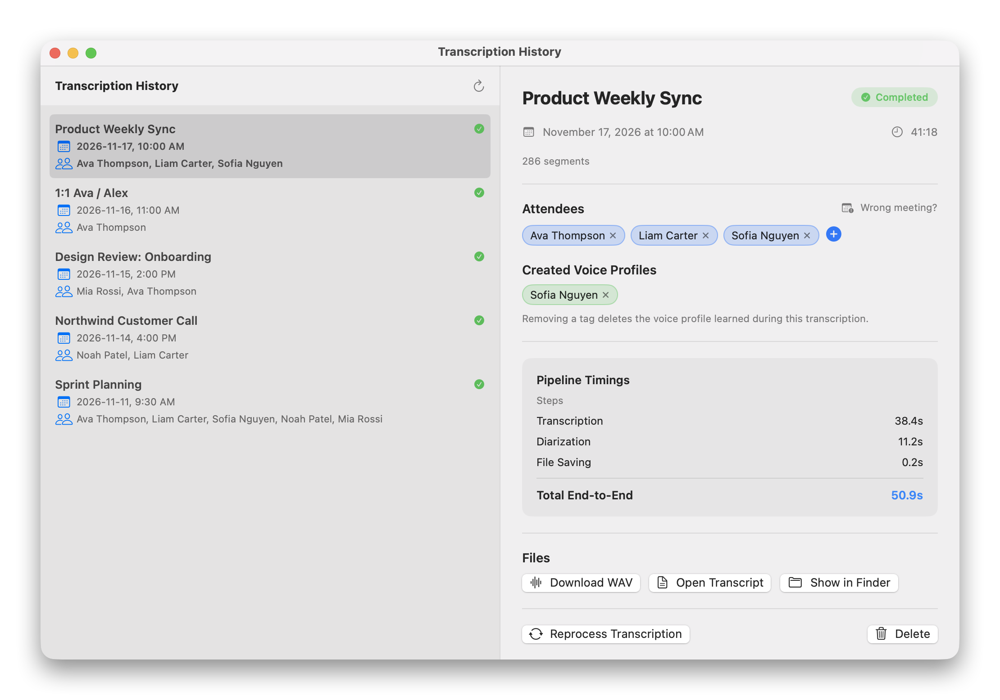

<p align="center">
  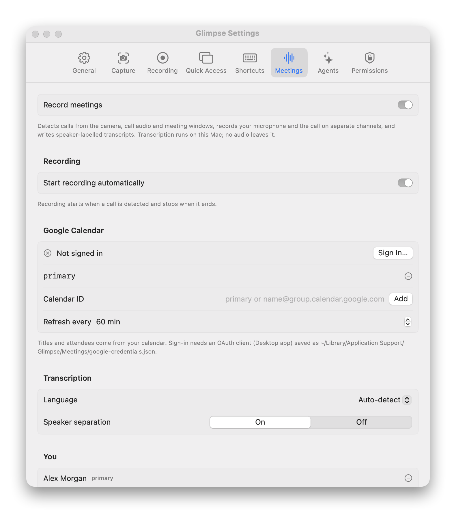
</p>

**Privacy.** Recording and transcription happen on your Mac: audio, transcripts, voice profiles and the calendar
token stay in your home folder, and the only network traffic is the first-use download of the speech, speaker and
voice-activity models (from Hugging Face) and, if you sign in, Google Calendar. The microphone is captured while a
recording is running, during the 15-second voice enrolment, and briefly for voice-activity detection once call
traffic and a meeting window already indicate a call. You are responsible for telling the people you record, where
that's required.

### Quick Access Overlay

Every capture slides into a corner of the screen. Hover it for **Copy** and **Save**, and a row of buttons
to draw on it, keep it, copy its text, move it to [Recent Screenshots](#recent-screenshots) or **Send** it to
your agent. **Keep** (the pin) stops the thumbnail from closing by itself until you click it again; Send keeps it
too, so a send you cancel leaves it where it was. To float the screenshot over your windows, right-click it
› **Pin to Screen**. Drag it straight into Slack, Mail, Finder or any other app. Swipe it away, or bring back the
last one you closed.

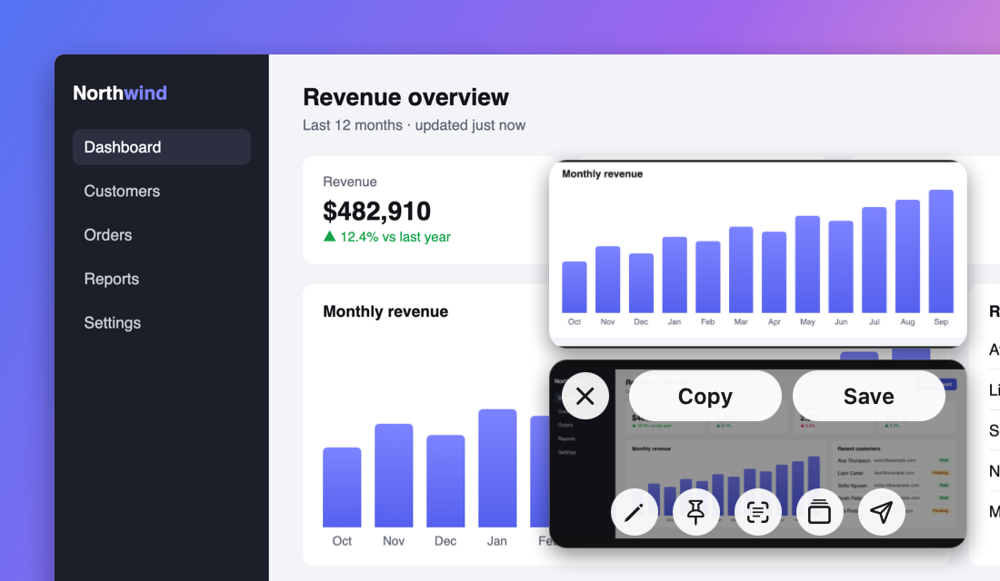

### Recent screenshots

Double-tap the right `Shift` key (or press `⌥⇧⌘0`) and your last 30 screenshots slide in as cards at the edge
of the screen, newest at the bottom. The stack opens without taking focus from the app you're in; close it
with `Esc` and you're right where you were.

- **Click a card** to draw on it. Close the editor and you're back in the stack.
- **Select several** with `⌘`-click, `⇧`-click, `Space` or `⇧↑`/`⇧↓`, then **Copy** `⌘C`, **Draw** `↩`,
  **Stitch** `⌘S`, **Send** `⌘↩` or **Remove** `⌘⌫`. **Remove All** `⌘⇧⌫` (in the bar or the right-click menu)
  empties the stack after asking, keeping any screenshots an agent is waiting for you to choose from.
- **Drag** one or more cards into Claude Code, Slack, a chat or Finder. If you drew on a card, the dropped
  image has your drawing on it.
- **Several in a row**: select a few and press `↩`. Copy or send one, and the next one opens.
- **Stitch** joins the selected cards into one image and numbers each piece in the order you picked them.
  Claude shrinks large images before it reads them (to about 1568 px and 1.15 megapixels), so Stitch picks
  the arrangement that's shrunk the least, keeping the most detail of every piece.

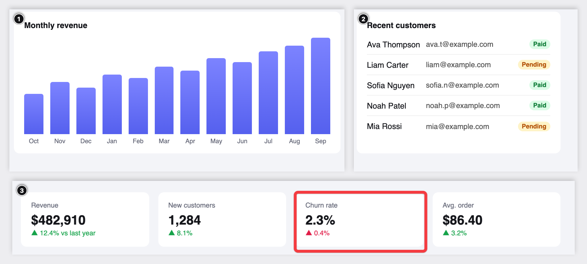

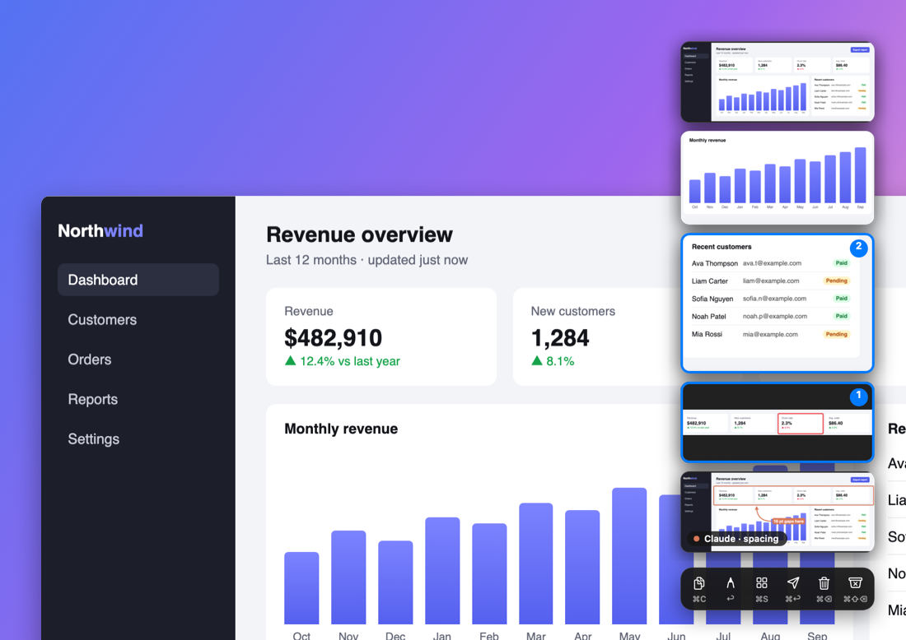

Your marks stay editable: open a card again to move, change or delete any of them. The cards are kept in
`~/Library/Application Support/Glimpse/Recent` (turn that off in **Settings › Quick Access**). Watching for
the Shift double-tap needs the Accessibility permission.

### Send to your agent

Draw on a screenshot and press **Send** (`⌘↩`, in the editor or the stack). With one Claude Code or Codex session
running, it goes straight there, in a terminal, an editor or the Claude app. With several, a menu lists them by title
(or folder), with the folder and the app each runs in. The one whose window you used last comes first: press `↩` to
send there, or pick another (the next ones answer to `2` to `9`). Closing the menu sends nothing and leaves the
editor or stack open.

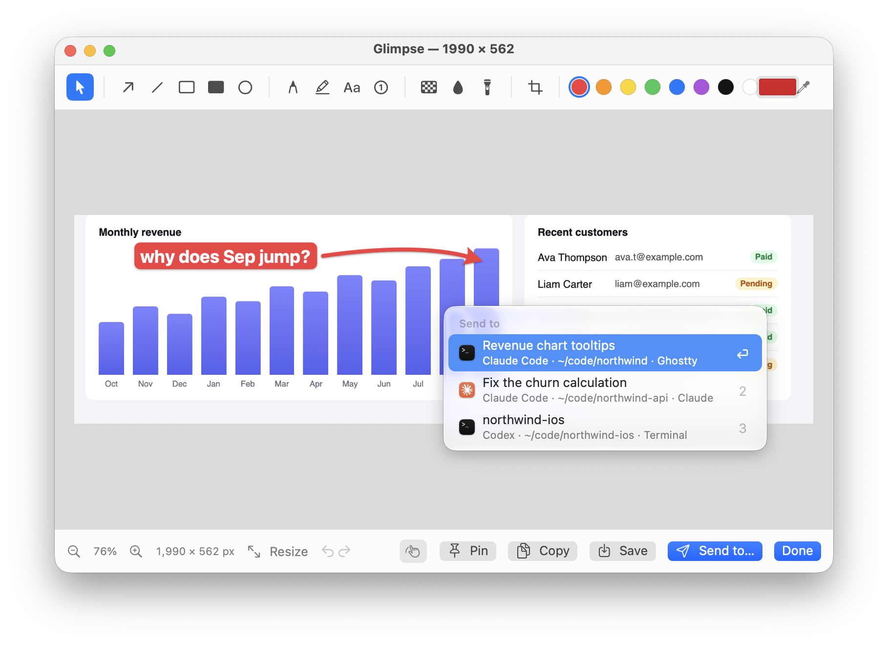

Send needs Glimpse's Claude Code plugin: **Settings › Agents › Claude Code plugin › Install** (it runs
`claude plugin install` for you). The plugin keeps a small inbox for each running session. Send drops the
screenshot there, and Claude Code delivers it to the session as a message, between turns: sent while Claude is busy,
it waits for the turn to end. Nothing is typed into your terminal and no extra permission is needed. Sessions
already running pick the plugin up after `/reload-plugins` or a restart. In a terminal the plugin's monitor delivers
it; the Claude app runs Claude Code without plugin monitors, so there a hook does instead, waking Claude when the
screenshot arrives.

Codex, and Claude Code without the plugin, get the image's path pasted into their prompt instead (both attach a
pasted image path as the image). That needs the Accessibility permission; without it the path is left on the
clipboard. Neither route reaches a cloud session (claude.ai/code): they only see sessions running on this Mac.

Your agent can draw too, in its own colour. Through Glimpse's [MCP server](#ai-agents-mcp) it can put a
screenshot with its arrows, boxes, numbers and notes in your stack, open one with a question and wait for you to
draw your answer and send it back, or show you a few versions and ask which one you like.

### Annotate

Arrow, line, rectangle, filled rectangle, ellipse, pen, highlighter, text (plain, outline or background),
numbered steps, **pixelate** and **blur** for redaction, spotlight, crop and resize. Every annotation stays
editable: select, move, resize, restyle or delete it. Colour presets, a custom colour, an eyedropper,
undo/redo and zoom. Each tool has a single-key shortcut.

- **The arrow draws like a pencil** and puts a head on the end: curve it around what's in the way, or keep
  it straight (a nearly straight stroke becomes a clean straight arrow; hold `⇧` to snap the angle).
- **Draw a box or an arrow and start typing**, and your note appears beside it: to the right of a box, past
  the tail of an arrow. (Turn it off in **Settings › Capture** to keep single-key tool shortcuts right after
  drawing.)

### Pin

Keep a screenshot floating above every window while you work. Resize it, fade it, nudge it with the arrow
keys, or lock it so clicks pass through.

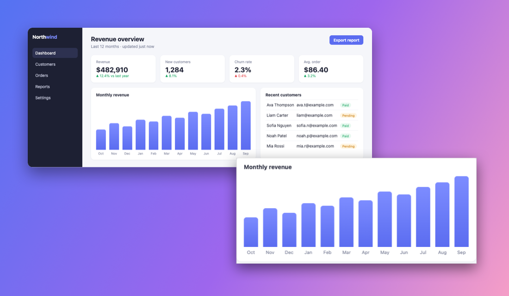

### And

- Every capture shortcut is configurable, and captures can be scripted with `glimpse://` URLs.
- AI agents (Claude Code, Claude Desktop, Cursor, …) can take screenshots, read text, record the screen,
  search and read meeting transcripts, and draw on screenshots to show or ask you something, through
  Glimpse's [MCP server](#ai-agents-mcp).
- Settings for what happens after a capture (overlay, clipboard, auto-save, open editor), save folder,
  PNG or JPEG, overlay position and size, recording (frame rate, resolution, cursor, countdown, audio and
  camera devices, bubble shape and size), meetings (calendar, language, speaker separation, your voice,
  detection timing), the data folder for transcripts, and launch at login.

<p align="center">
  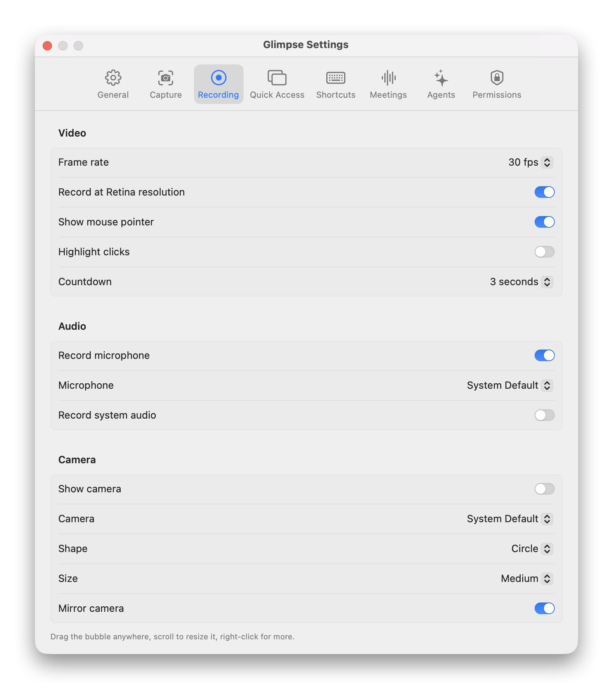
</p>

## Install

Run this in Terminal:

```sh
curl -fsSL https://raw.githubusercontent.com/miladbeigi/glimpse/master/install.sh | bash
```

It downloads the latest release, checks its SHA-256, installs **Glimpse.app** to `/Applications` (or
`~/Applications` if that isn't writable), and launches it. Read [`install.sh`](install.sh) first if you like;
it's short. Running it again updates or reinstalls. After that, Glimpse keeps itself up to date (see
[Updates](#updates)).

<details>
<summary>Manual install</summary>

1. Download `Glimpse-<version>.zip` from the [latest release](../../releases/latest) and unzip it.
2. Move **Glimpse.app** to `/Applications`.
3. The app isn't notarized by Apple, so macOS blocks the first launch. Double-click the app, click **Done**
   (not Move to Trash), then open **System Settings → Privacy & Security**, scroll down and click
   **Open Anyway**. Or skip the warning by running:

   ```sh
   xattr -dr com.apple.quarantine /Applications/Glimpse.app
   ```

</details>

### Permissions

On first launch a setup window walks you through them:

- **Screen Recording** (required): turn on Glimpse in **System Settings → Privacy & Security → Screen &
  System Audio Recording**, then click **Relaunch Glimpse**.
- **Accessibility** (optional): only used by auto-scroll in Scrolling Capture.
- **Camera** and **Microphone** (optional): asked the first time you record with the camera bubble or the
  microphone. Microphone is also asked when you turn on meetings; meeting recordings take the call's audio
  through the Screen Recording permission.

Release builds are ad-hoc signed, so after updating you may need to switch Glimpse off and on again in the
Screen Recording list.

### Updates

At launch and every 6 hours, Glimpse checks this repository's latest GitHub release. When a newer version is
out, **Update to Glimpse X.Y.Z** shows up at the top of the menu bar menu and in **Settings → General →
Updates**, which also has **Check Now** and a switch to turn automatic checks off. Updating downloads the zip,
checks its SHA-256 against the `.sha256` file published with the release, swaps the app in place and
relaunches.

The checksum confirms the download isn't corrupted; it isn't a signature. Anyone who can publish releases to
this repository can ship an update.

## Shortcuts

| Action | Default |
|---|---|
| Capture Area | ⌥⇧⌘4 |
| Capture Fullscreen | ⌥⇧⌘3 |
| Capture Window | ⌥⇧⌘5 |
| Scrolling Capture | ⌥⇧⌘6 |
| Capture Previous Area | ⌥⇧⌘7 |
| Self-Timer | ⌥⇧⌘8 |
| Capture Text | ⌥⇧⌘2 |
| Restore Recently Closed | ⌥⇧⌘9 |
| Record Screen (start / stop) | ⌥⇧⌘R |
| Recent Screenshots | ⌥⇧⌘0, or double-tap right ⇧ |
| Mute microphone (while meetings are on) | ⌃⌥M |

The defaults stay clear of macOS's own ⇧⌘3/4/5. To use those instead, turn off the system screenshot
shortcuts in **System Settings → Keyboard → Keyboard Shortcuts → Screenshots**, then set them in
Glimpse's Settings.

**In the editor:** V select · A arrow · L line · R rectangle · F filled rectangle · O ellipse · P pen ·
H highlighter · T text · N counter · X pixelate · B blur · S spotlight · C crop.
Hold ⇧ to snap angles and squares. ⌫ deletes, arrow keys nudge, ⌘D duplicates, ⌘Z / ⇧⌘Z undo and redo,
⌘C copy, ⌘S save, ⇧⌘S save as, ⌘P pin, ⌘↩ send, ⌘0 zoom to fit.

## Automation

Every capture mode can be triggered with a URL, from scripts, Shortcuts, Raycast or Alfred:

```sh
open "glimpse://capture-area"                                   # interactive
open "glimpse://capture-area?x=100&y=80&width=800&height=400"   # points from the top-left of the display
open "glimpse://capture-fullscreen?delay=3"
open "glimpse://capture-window"
open "glimpse://scrolling-capture?x=0&y=120&width=1200&height=900&autoscroll=1"
open "glimpse://self-timer?x=200&y=150&width=1000&height=600&delay=5"
open "glimpse://capture-text?x=0&y=0&width=1200&height=300"
open "glimpse://annotate?filepath=/path/to/image.png"
```

Recent screenshots: `recent` shows the stack, `stitch-recent?count=3` stitches the last three, and
`send-latest` sends the newest one to your agent.

Also `capture-previous-area`, `restore-recently-closed`, `annotate-clipboard`, `pin-clipboard`,
`pin?filepath=…`, `open-settings` (optionally `?tab=shortcuts`) and `permissions`. Region commands accept `display=N` (1-based).

Screen recordings:

```sh
open "glimpse://record-screen"                                          # interactive
open "glimpse://record-screen?x=0&y=0&width=1280&height=720&duration=30" # starts right away, stops after 30 s
open "glimpse://record-fullscreen?display=2&camera=1&mic=1&countdown=0"
open "glimpse://stop-recording"
```

With a region, or with `record-fullscreen`, recording starts without the control bar's ready step; add
`autostart=0` to stop there instead (or `autostart=1` to skip it after an interactive selection). Options:
`camera`, `mic` and `systemaudio` (`0` or `1`, default from Settings), `countdown=N` seconds and `duration=N` to
stop after N recorded seconds. Also `pause-recording`, `resume-recording`, `restart-recording` and
`discard-recording`.

## AI agents (MCP)

Glimpse includes an [MCP](https://modelcontextprotocol.io) server, so coding agents and other AI tools can see
your screen. Turn on **Settings › Agents › Allow AI agents to take screenshots and read meeting transcripts**,
then connect your agent:

```sh
claude mcp add glimpse -- /Applications/Glimpse.app/Contents/MacOS/Glimpse mcp
```

Other clients take the same command in their MCP config:

```json
{ "mcpServers": { "glimpse": { "command": "/Applications/Glimpse.app/Contents/MacOS/Glimpse", "args": ["mcp"] } } }
```

| Tool | What it does |
|---|---|
| `list_windows` | On-screen windows front to back: id, app, bundle id, title, bounds |
| `list_displays` | Displays with frame and scale |
| `screenshot_window` | One window by `window_id`, or `app` and/or `title`, even when it's covered |
| `screenshot_screen` | A whole display |
| `screenshot_region` | A rectangle, in the same screen coordinates as `list_windows` |
| `read_text` | On-device OCR (and QR codes) of a window, region or display |
| `start_recording` | Records a window, region or display to MP4 (optionally with system audio), stopping by itself after `max_duration` seconds |
| `stop_recording` | Stops the recording and returns the file path, duration and still frames from it |
| `recording_status` | Whether a recording is running, its id, elapsed time and limit |
| `meeting_search` | Finds recorded meetings by words in the title, attendees or what was said (`query`, all words must appear, `"quoted phrases"` kept together), `attendee`, and `from`/`to` dates; returns each meeting's date, title, attendees, transcript path and the matching paragraphs by speaker |
| `meeting_transcript` | The transcript of a recorded meeting, by `path` from `meeting_search`, or a `time` during it or part of its `title` (and `date`); with none, the day's recorded meetings |
| `list_screenshots` | The user's recent screenshots (the stack), newest first: id, time, size, who made it, label, number of marks |
| `get_screenshot` | One recent screenshot as the user marked it up, with its marks as data |
| `show_image` | Puts an image (a file, or a recent screenshot) with the agent's marks into the user's stack, or opens it in the editor |
| `ask_user` | Opens an image with the agent's marks and a question, and waits until the user draws an answer and sends it; returns the marked-up image and the user's marks |
| `ask_user_to_choose` | Shows 2–8 images as cards with a question and waits for the user to send one back; returns which one (and the image, if they drew on it) |

Agents draw with `marks`: `arrow` (`from`/`to`, or `points` for a curved one), `line`, `box`, `ellipse`, `text`
(`at`, `text`), `number` (numbered in order), `pen`, `highlight`, `spotlight` and `blur`, in pixels of the image
(or of an `image_width`-wide copy). Arrows and boxes take a `label`, written beside them. Each agent draws in its
own colour (Claude in terracotta, Codex in green) and its cards say who made them. When an agent is waiting on
`ask_user` or `ask_user_to_choose`, **Send** answers it instead of pasting into the terminal.

Screenshots come back inline, scaled to `max_size` (1568 px on the long edge by default, `0` for full size), and
are also saved at full resolution (`save_path`, or a temporary folder); the result includes the file path and the
captured frame for mapping pixels to screen points. `format: "jpeg"` makes them smaller and `include_image: false`
returns only the path.

Recording has its own switch, **Settings › Agents › Allow AI agents to record the screen**, off by default. Agent
recordings never include the microphone or camera, show Glimpse's usual recording controls and menu bar timer (so
you can see and stop them), and stop after `max_duration` (60 s by default, 10 minutes at most). They're saved to
`save_path` or a temporary folder, not the screenshots folder. `stop_recording` returns `frames` stills (4 by
default) spread across the video so the agent can see what it recorded. If you're already recording,
`start_recording` fails rather than taking over.

`meeting_search` and `meeting_transcript` read the transcripts Glimpse wrote (see [Meetings](#meetings)), including
ones you moved into other folders inside `Meetings/`; they can't start or stop a meeting recording.

`Glimpse mcp` does no capturing itself: it forwards calls to the Glimpse app (launching it if needed) over a
socket only your user can open, so captures use Glimpse's Screen Recording permission, not your terminal's.

## Build from source

Requires Xcode 15.3 or later (or a Swift 5.10+ toolchain) and macOS 14.

```sh
git clone https://github.com/miladbeigi/glimpse.git
cd glimpse
scripts/build.sh --install   # builds build/Glimpse.app, copies it to /Applications and launches it
```

Other options:

```sh
swift test                   # unit tests
scripts/build.sh             # build only (universal)
scripts/build.sh --zip       # also write build/Glimpse-<version>.zip and .sha256
scripts/build.sh --debug     # debug build in build/debug/Glimpse.app
```

macOS ties the Screen Recording and Microphone permissions to the app's signing certificate, so every build
carries one shared self-signed identity: local builds on any Mac and the GitHub releases alike. Installing a
local build over a release, a release over a local build, or either on another Mac then never asks for them
again. `scripts/signing-identity` pins its SHA-1; `build.sh` warns about (and `--install` refuses) any other
signature. The Release workflow signs with the identity in the repo's Actions secrets (`--github` below).

On a new Mac, import the identity once from the file kept in your password manager:

```bash
scripts/setup-signing.sh --import glimpse-signing.p12   # asks for the file's password
scripts/setup-signing.sh --check
```

It lives in its own keychain under `~/Library/Application Support/Glimpse-dev/`. `--export FILE.p12` writes it
out again, `--github` puts it in the repo's Actions secrets for releases, and `--new` only exists to replace it
everywhere.

## Development

- Code is in `Sources/Glimpse` (the editor in `Sources/Glimpse/Editor`), tests in `Tests/GlimpseTests`.
  Meetings are two library targets: `Sources/Meetings` (recording, transcription, calendar, history) and
  `Sources/MeetingDetection` (the call-detection signals and state machine), with tests alongside.
  [`SPEC.md`](SPEC.md) describes the features and architecture.
- Meeting recordings, history and settings live in `~/Library/Application Support/Glimpse/Meetings/`; the debug
  log is `~/Library/Logs/Glimpse/meetings.log` (**Settings › Meetings › Debug log**). Launch with
  `GLIMPSE_MEETINGS_UI_TEST=1` to try the meetings UI without detection, calendar polling or crash recovery.
- `scripts/smoke-test.sh` drives real captures against the installed app through URL commands. Test settings
  are passed as launch arguments, so your saved preferences are never touched.
- The app icon is generated by `swift scripts/make-icon.swift`.
- The screenshots in `docs/` are rendered by the app itself from a sample image (debug builds only):

  ```sh
  scripts/build.sh --debug
  open -n build/debug/Glimpse.app --env GLIMPSE_DOCS_DIR="$PWD/docs" --env GLIMPSE_DOCS_SAMPLE=/path/to/sample.png
  ```

  The sample is [`docs/sample.html`](docs/sample.html), a made-up dashboard: screenshot it at 1200 × 486 points
  on a Retina display (or at 2× in a browser) and save it at 144 dpi, so the marks land where the scenario expects.

  Add `--env GLIMPSE_DOCS_ONLY=recording` to render only `recording.png` and `settings.png`, or
  `--env GLIMPSE_DOCS_ONLY=recent` for `editor.png`, `overlay.png`, `recent.png` (the stack), `stitch.png` and
  `send.png` (the Send menu, listing made-up sessions). The renderer never reads or writes your own recent screenshots. The camera bubble
  shows `--env GLIMPSE_DOCS_AVATAR=/path/face.png` (an AI-generated face, not a real person) or a drawn
  silhouette, never your camera.

  `--env GLIMPSE_DOCS_ONLY=meetings` renders only `meeting.png` (the meeting pill under a video call: pass the
  call window as `--env GLIMPSE_DOCS_CALL=/path/call.png`, otherwise the sample is used), `transcripts.png`
  (Transcription History with sample meetings of fictional people) and `settings-meetings.png`. The sample
  meetings, settings and voice profiles go to a temporary folder that's deleted afterwards; your meeting history
  and transcripts are never read or written. Add `--args -meetingsEnabled YES` to show meetings turned on without
  saving it. The renderer runs beside an installed Glimpse.

## Releasing

```sh
scripts/release.sh patch        # or minor, major, or an exact version like 1.2.0
```

It checks that you're on an up-to-date, clean `master`, writes `VERSION`, commits, tags `v<version>` and pushes.
The **Release** workflow then runs the tests, builds a universal app and publishes `Glimpse-<version>.zip` and
its `.sha256` to a GitHub release. `install.sh` and the in-app updater both pick it up from there. Follow the
build with `gh run watch`.

The **CI** workflow runs the tests and builds the app on every push to `master` and every pull request.

## License

[MIT](LICENSE)
